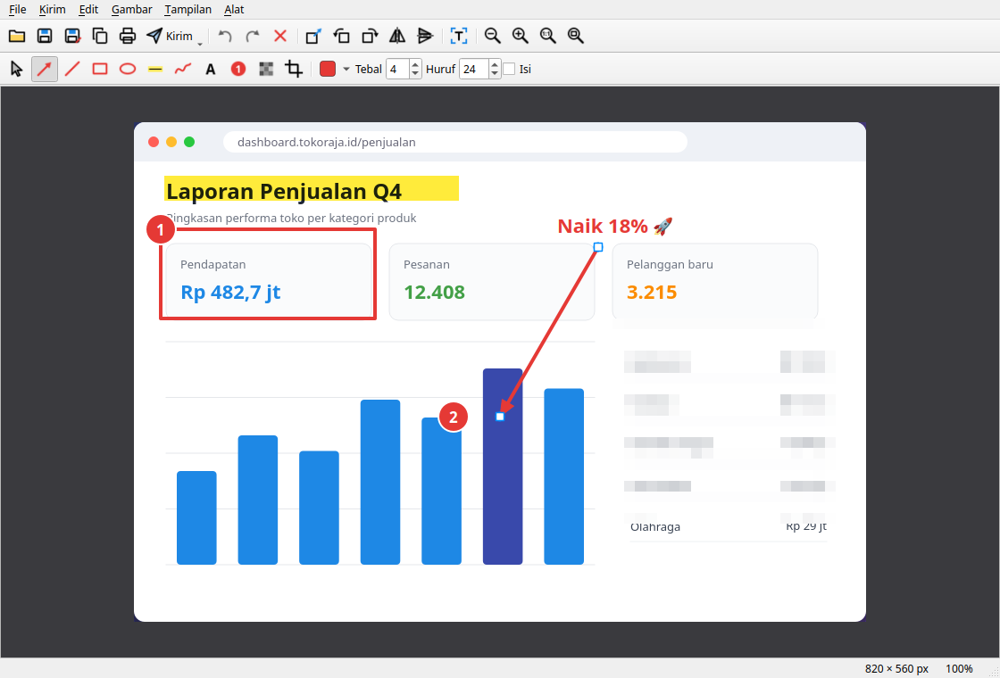
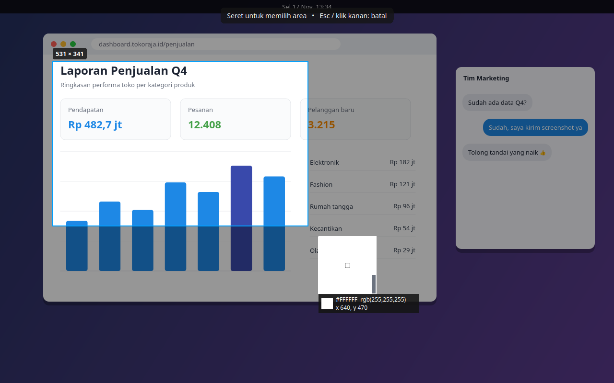
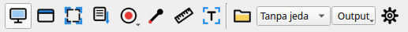

<div align="center">


# Raja Capture

**Capture, annotate, record and share your screen — on Linux (Wayland & X11) and Windows.**

[](https://github.com/firexsantos/raja-capture/actions/workflows/build.yml)
[](https://github.com/firexsantos/raja-capture/releases/latest)
[](LICENSE)


[Website](https://firexsantos.github.io/raja-capture/) ·
[Download](https://github.com/firexsantos/raja-capture/releases/latest) ·
[Report a bug](https://github.com/firexsantos/raja-capture/issues)



</div>

---

Raja Capture is a free, open-source screen capture suite in the spirit of classic
all-in-one capture tools: a small floating toolbar, a fast region selector with a
pixel magnifier, a full annotation editor, a screen recorder, OCR and one-click
sharing. It is built with Python and Qt 6 and works natively on modern **Wayland**
desktops through `xdg-desktop-portal`.

> 🇮🇩 Antarmuka aplikasi saat ini berbahasa Indonesia.

## Table of contents

- [Features](#features)
- [Screenshots](#screenshots)
- [Installation](#installation)
- [Usage](#usage)
- [Configuration](#configuration)
- [Platform support](#platform-support)
- [Building from source](#building-from-source)
- [Architecture](#architecture)
- [Changelog](#changelog)
- [Contributing](#contributing)
- [License](#license)

## Features

**Capture**
- Full screen, active window, rectangular region and **scrolling capture** with auto-scroll (long pages stitched automatically, sticky headers/footers handled, stops at the end of the page)
- Optional delay timer (3 / 5 / 10 s) for menus and tooltips
- Frozen-screen region selector with crosshair, live size label and pixel magnifier
- Multi-monitor and HiDPI aware

**Annotate**
- Arrow, line, rectangle, ellipse, freehand pen, text, highlighter, numbered steps and pixelate (redact)
- Resize handles, Shift-constrained drawing, colour palette, line width, font size, fill
- Crop, resize, rotate, flip, add border — all with unlimited undo/redo
- Save as PNG, JPG, BMP, WEBP or PDF; copy to clipboard; print

**Record**
- Screen or region recording to MP4 (H.264)
- Audio from microphone, system output, or both
- Remembers your screen choice on Wayland, recording indicator with timer

**Tools**
- Colour picker (HEX / RGB / HSL), on-screen ruler, OCR text extraction (Tesseract)

**Share**
- Upload to Imgur or to your own server (ShareX-style custom uploader) with upload history
- Email as attachment, open with another program, copy as file, reveal in folder

**Workflow**
- System tray, global hotkeys (`Ctrl+Alt+1` … `Ctrl+Alt+9`), single-instance command line
- Choose what happens after a capture: open editor, auto-save, copy, or save + copy

## Screenshots

| Region selection | Floating toolbar |
|---|---|
|  |  |

## Installation

Download the latest packages from the
[**Releases**](https://github.com/firexsantos/raja-capture/releases/latest) page.

### Linux

**AppImage** (any modern distribution):

```bash
chmod +x RajaCapture-*-x86_64.AppImage
./RajaCapture-*-x86_64.AppImage
```

**Debian / Ubuntu**:

```bash
sudo apt install ./raja-capture_*_amd64.deb
```

Optional runtime components (installed automatically as recommendations by the `.deb`):

| Feature | Packages |
|---|---|
| Recording on Wayland | `gstreamer1.0-pipewire gstreamer1.0-tools gstreamer1.0-plugins-ugly gstreamer1.0-plugins-bad` |
| Recording on X11 | `ffmpeg` |
| OCR | `tesseract-ocr` (+ `tesseract-ocr-ind` for Indonesian, etc.) |

### Windows

Run `RajaCapture-<version>-setup.exe`, or unzip the portable build and start
`raja-capture.exe`. For recording, install [ffmpeg](https://ffmpeg.org/download.html)
and make sure it is on your `PATH` (or set its location in *Settings*). For OCR,
install [Tesseract](https://github.com/UB-Mannheim/tesseract/wiki).

### From source

```bash
git clone https://github.com/firexsantos/raja-capture.git
cd raja-capture
python3 -m venv .venv
.venv/bin/pip install -e .            # add ".[x11]" on X11 for window picking & hotkeys
.venv/bin/raja-capture
```

## Usage

Launch Raja Capture to open the floating toolbar; it keeps running in the system tray.

| Action | Default hotkey | Command line |
|---|---|---|
| Full screen | `Ctrl+Alt+1` | `raja-capture --full` |
| Window | `Ctrl+Alt+2` | `raja-capture --window` |
| Region | `Ctrl+Alt+3` | `raja-capture --region` |
| Scrolling capture | `Ctrl+Alt+4` | `raja-capture --scroll` |
| Record region | `Ctrl+Alt+5` | `raja-capture --record-region` |
| Record screen | `Ctrl+Alt+6` | `raja-capture --record-full` |
| Colour picker | `Ctrl+Alt+7` | `raja-capture --color` |
| Ruler | `Ctrl+Alt+8` | `raja-capture --ruler` |
| OCR region | `Ctrl+Alt+9` | `raja-capture --ocr` |

Other options: `--tray`, `--show`, `--settings`, `--quit`, or pass image files to open them in the editor.
When Raja Capture is already running, these commands are forwarded to the running instance.

**Selector:** drag to select · click a window (window mode) · `Enter` for the whole monitor · `Esc` / right-click to cancel.
**Editor:** single-key tools `V A L R E H P T N B C` · `Shift` to constrain · `Ctrl` + wheel to zoom · middle-drag to pan · arrow keys to nudge.

> **GNOME on Wayland:** Wayland does not let applications grab global keys. Open
> *Settings → Shortcut → Apply to GNOME* and Raja Capture registers the hotkeys as
> GNOME custom shortcuts that call the commands above.

## Configuration

All options live in *Settings* (tray menu or toolbar):

- **General** — output folders, file-name pattern (`strftime`), image format and quality, after-capture action
- **Shortcut** — hotkeys per action, GNOME integration
- **Recording & OCR** — frame rate, cursor, audio source, ffmpeg/Tesseract locations, OCR language (`eng`, `ind`, `eng+ind`, …)
- **Send** — Imgur Client ID ([register for free](https://api.imgur.com/oauth2/addclient)); custom uploader URL, form field, headers (JSON) and the JSON path of the returned link (e.g. `data.url`)
- **System** — start at login, install the application-menu entry

## Platform support

| | Linux · Wayland | Linux · X11 | Windows |
|---|:---:|:---:|:---:|
| Full screen / region / delay | ✅ portal | ✅ | ✅ |
| Window capture | ✅ portal picker | ✅ hover highlight¹ | ✅ hover highlight |
| Scrolling capture | ✅ manual + auto (RemoteDesktop portal) | ✅ manual + auto¹ | ✅ manual + auto |
| Screen recording + audio | ✅ PipeWire / GStreamer | ✅ ffmpeg | ✅ ffmpeg² |
| Global hotkeys | ✅ via GNOME shortcuts | ✅ pynput¹ | ✅ native |
| Editor, OCR, colour picker, ruler, sharing | ✅ | ✅ | ✅ |

¹ requires the `x11` extra (`pip install "raja-capture[x11]"`).
² system audio needs a loopback device such as *Stereo Mix*.
macOS: capture and editor work through Qt; recording is not supported yet.

## Building from source

```bash
.venv/bin/pip install pyinstaller pytest
.venv/bin/python -m pytest -q                                        # tests (run offscreen)
PYTHON=.venv/bin/python packaging/build_linux.sh                     # AppImage + .deb → dist/
SKIP_APPIMAGE=1 PYTHON=.venv/bin/python packaging/build_linux.sh     # .deb only
```

Windows (PowerShell, requires [Inno Setup 6](https://jrsoftware.org/isinfo.php)):

```powershell
pip install . pyinstaller
python packaging\make_icons.py
python -m PyInstaller --noconfirm packaging\raja-capture.spec
iscc /DAppVersion=0.2.0 packaging\windows\installer.iss
```

Every push runs the test suite and builds Linux and Windows packages on GitHub
Actions; pushing a `v*` tag publishes them as a GitHub Release.

## Architecture

```
raja_capture/
├── app.py               application controller, tray, capture flow, CLI
├── capture/             backends: portal.py (Wayland), Qt + winenum / x11enum
├── ui/
│   ├── overlay.py       region / window / colour / ruler selector
│   ├── editor.py        annotation editor (QGraphicsScene, undo stack)
│   ├── items.py         annotation items and resize handles
│   └── scroll_capture.py
├── stitch.py            image stitching for scrolling capture (NumPy)
├── recorder.py          GStreamer / ffmpeg screen recorder
├── share.py             uploads, email, open-with, clipboard
├── hotkeys.py · ipc.py  global hotkeys and single-instance IPC
└── ocr.py · imageio.py · system.py · config.py
packaging/               PyInstaller spec, AppImage/.deb script, Inno Setup installer
docs/                    project website (GitHub Pages)
```

## Changelog

Raja Capture checks for new releases and offers a one-click upgrade from inside the app
(tray menu → *Cek pembaruan…*).

<!-- changelog:start -->
### 0.4.0 — 2026-11-17

#### Added
- Auto-scroll for scrolling capture on Wayland through the RemoteDesktop portal (GNOME asks
  once and remembers the choice); the pointer is moved onto the selected area automatically.
- Scrolling capture can be stopped from the tray (*Hentikan tangkap scroll*) or by pressing
  the scrolling-capture hotkey again.

#### Fixed
- Scrolling capture on Wayland produced broken results: the control panel and the toolbar
  appeared inside the captured frames. Both are now hidden while capturing.
- Frames were grabbed on a fixed timer, sometimes in the middle of a smooth-scroll animation;
  capture now scrolls, waits for the content to settle, then grabs.
- Capture stops automatically at the end of the page (or a few seconds after manual scrolling
  stops), detects an inverted wheel direction and takes smaller steps when it scrolls too far.

### 0.3.0 — 2026-11-17

#### Added
- In-app update notifications: Raja Capture checks GitHub Releases at startup and every
  6 hours, and shows a popup with the new version and its release notes.
- One-click upgrade: the Windows installer, AppImage and `.deb` builds download, verify
  (SHA-256) and install the new version, then restart automatically.
- *Check for updates* and *About* entries in the tray menu; update options in Settings → System.
- `CHANGELOG.md`, with the latest entries mirrored into the README and used as release notes.

#### Fixed
- Wayland/GNOME: capturing failed with "Portal Screenshot gagal (kode 2)" when Raja Capture
  was installed from the `.deb`/app menu. GNOME requires a one-time screenshot permission that
  it only asks for while the app has focus; Raja Capture now requests it from a focused dialog
  (with a *reset* option if it was denied before) and retries the capture.

### 0.2.0 — 2026-11-17

#### Added
- Resize handles for rectangles, ellipses, highlights, pixelate areas, lines and arrows.
- Audio recording: microphone, system audio, or both.
- *Send* menu: upload to Imgur or a custom server, upload history, email attachment,
  open with another program, copy as file, reveal in folder.
- Installers: AppImage, `.deb`, Windows setup and portable zip, built by GitHub Actions.
- MIT license, project website and a new README.

#### Fixed
- Magnifier was dimmed while dragging a selection.
- Settings tab label "Rekam & OCR" displayed incorrectly.

See [CHANGELOG.md](CHANGELOG.md) for the full history.
<!-- changelog:end -->

## Contributing

Bug reports, ideas and pull requests are welcome.

1. Fork the repository and create a feature branch.
2. Install in editable mode and run `python -m pytest -q` before submitting.
3. Keep changes focused and describe the platform(s) you tested on.

Please open an [issue](https://github.com/firexsantos/raja-capture/issues) first for larger changes.

## License

Released under the [MIT License](LICENSE). © 2026 Firman Santosa.
